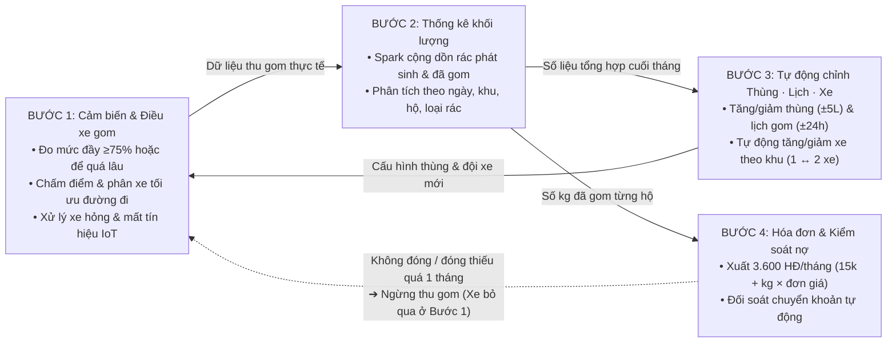
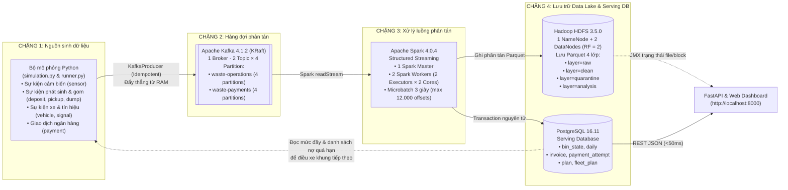

# TÀI LIỆU MÔ TẢ TOÀN DIỆN DỰ ÁN: TRẠM ĐIỀU PHỐI RÁC TUẤN HÙNG (QUẢN LÝ THU GOM & TÍNH PHÍ RÁC HỘ GIA ĐÌNH)

> **Mục đích tài liệu:** Tài liệu này mô tả chi tiết từ A–Z toàn bộ **Bài toán, Vòng tròn Nghiệp vụ, Công thức tính toán, Kiến trúc kỹ thuật Big Data, Cấu trúc Mã nguồn, Hướng dẫn Chạy và Kịch bản Thuyết trình Demo 5 phút** dành cho thành viên mới hoặc người nhận bàn giao chưa biết gì về dự án có thể nắm bắt và báo cáo được ngay.

---

## 1. TỔNG QUAN BÀI TOÁN & QUY MÔ HỆ THỐNG

### 1.1. Bối cảnh bài toán
Trong quản lý rác thải đô thị, nếu thu gom theo lịch cố định cứng nhắc sẽ xảy ra tình trạng: có nhà thùng rác đã tràn hoặc để quá lâu gây ô nhiễm nhưng xe chưa tới, trong khi nhà khác thùng còn rỗng xe vẫn chạy qua gây lãng phí nhiên liệu; đồng thời việc thu phí cào bằng không khuyến khích phân loại rác và khó kiểm soát nợ đọng.

Dự án xây dựng một **Trạm Điều Phối Thông Minh trên nền tảng Big Data** giải quyết trọn vẹn một **vòng tròn nghiệp vụ khép kín**:
1. Thu nhận dữ liệu cảm biến từ từng thùng rác của từng hộ gia đình để cảnh báo mức đầy và điều phối xe đi gom tối ưu quãng đường.
2. Thống kê khối lượng rác phát sinh và đã thu gom theo thời gian thực qua **Kafka & Spark Structured Streaming**, lưu trữ lịch sử đa lớp trên **Hadoop HDFS**.
3. Cuối mỗi tháng, dựa trên thống kê thực tế để **tự động tăng/giảm thể tích thùng rác, tần suất thu gom cho từng hộ** và **tự động tăng/giảm số lượng xe thu gom cho từng khu**.
4. Tính tiền rác theo đúng khối lượng đã gom của từng loại rác, xuất hóa đơn hàng tháng, đối soát giao dịch chuyển khoản và **tự động ngừng thu gom (xe bỏ qua)** đối với những hộ không thanh toán hoặc thanh toán thiếu tiền sau 1 tháng kể từ ngày xuất hóa đơn.

### 1.2. Quy mô danh mục trong hệ thống
| Đối tượng | Số lượng | Quy ước mã & Mô tả chi tiết |
| :--- | :--- | :--- |
| **Khu dân cư (Zone)** | **60 khu** | Từ `Khu 01` đến `Khu 60`. Mỗi khu có đúng **60 hộ gia đình**. |
| **Hộ gia đình (Household)** | **3.600 hộ** | Mã từ `H-0001` đến `H-3600` (VD: `H-0001`..`H-0060` thuộc Khu 01; `H-0061`..`H-0120` thuộc Khu 02). Mỗi hộ có tọa độ `(x, y)`, số nhân khẩu (1–6 người) và hệ số sinh hoạt riêng. |
| **Thùng rác gắn cảm biến (Bin)** | **10.800 thùng** | Mỗi hộ có **3 thùng riêng biệt** theo 3 loại rác:<br>• **Hữu cơ (`organic` - mã đuôi `-O`)**: Dung tích gốc `20 L`, khối lượng riêng `220 g/L` (sức chứa gốc `4.400 g`), lịch gom gốc `72 giờ`, tải trọng xe `22 kg`.<br>• **Tái chế (`recycle` - mã đuôi `-R`)**: Dung tích gốc `30 L`, khối lượng riêng `65 g/L` (sức chứa gốc `1.950 g`), lịch gom gốc `72 giờ`, tải trọng xe `13 kg`.<br>• **Còn lại (`other` - mã đuôi `-C`)**: Dung tích gốc `20 L`, khối lượng riêng `135 g/L` (sức chứa gốc `2.700 g`), lịch gom gốc `72 giờ`, tải trọng xe `18 kg`.<br>*(Ví dụ: Hộ `H-0001` có 3 thùng là `H-0001-O`, `H-0001-R`, `H-0001-C`)*. |
| **Đội xe thu gom (Truck)** | **180 – 360 xe** | Ban đầu mỗi khu có 3 xe chính cho 3 loại rác (`X-01-O`, `X-01-R`, `X-01-C` ... đến Khu 60 là **180 xe chính**). Cuối mỗi tháng, khu nào có nhu cầu thu gom cao sẽ được hệ thống **tự động cấp thêm xe tăng cường số 2** (mã đuôi `-2`, VD: `X-01-O-2`); khi nhu cầu giảm xe số 2 tự động rút về dự phòng (`standby`). |
| **Đồng hồ mô phỏng** | **12 giờ / bước** | Bắt đầu từ `30/10/2026 00:00` (giờ Việt Nam `UTC+7`). Mỗi bước (frame) mô phỏng 12 giờ ngoài đời thực (mất khoảng 3,5 giây chạy thực tế). |

---

## 2. VÒNG TRÒN NGHIỆP VỤ KHÉP KÍN (4 BƯỚC TRÊN DASHBOARD)



---

### BƯỚC 1: Cảm biến cảnh báo & Điều phối xe thu gom (Tab 01 - `Cảnh báo & điều xe`)

1. **Cách cảm biến đo và quy đổi ra % thể tích đầy:**
   - Cảm biến gắn tại từng thùng rác gửi số đo khối lượng rác hiện có trong thùng (đơn vị `g` hoặc `kg`).
   - Hệ thống quy đổi sang `gram` nguyên và tính **% mức đầy thể tích (`fill_pct`)**:
     $$\text{Mức đầy (\%)} = \frac{\text{Khối lượng đo (g)}}{\text{Dung tích thùng (L)} \times \text{Khối lượng riêng (g/L)}} \times 100\%$$
   - **4 ngưỡng cảnh báo hiển thị trên hệ thống:**
     - `Bình thường (normal)`: **< 75%**
     - `Gần đầy (high)`: **Từ 75% đến dưới 95%**
     - `Đã đầy (full)`: **Từ 95% đến 100%**
     - `Quá tải (overload)`: **Trên 100%**
     - `Để quá lâu (stale / late)`: Thùng đang có rác (`grams > 0`) và thời gian kể từ lần thu gom gần nhất đã chạm hoặc vượt ngưỡng lịch gom của thùng (`interval_h`, mặc định 72 giờ). Cảnh báo này có thể xuất hiện độc lập hoặc đi kèm cảnh báo mức đầy.

2. **Điều kiện một thùng rác được đưa vào danh sách cần gom:**
   - Thùng có rác, không bị mất tín hiệu cảm biến, chưa có xe nào đang nhận nhiệm vụ, **hộ gia đình không nằm trong danh sách nợ quá hạn (`overdue`)**, và thỏa mãn:
     $$\text{Mức đầy} \ge 75\% \quad \text{HOẶC} \quad \text{Thời gian chờ} \ge \text{Lịch gom của thùng (interval\_h)}$$

3. **Thuật toán chấm điểm ưu tiên và tối ưu quãng đường phân xe:**
   - Mỗi thùng cần gom được tính điểm ưu tiên (`priority`):
     $$\text{Điểm ưu tiên} = \min(\text{Mức đầy}, 160) \times 0.14 + \min\left(\frac{\text{Giờ chờ}}{\text{interval\_h}}, 3\right) \times 5 + \min(\text{Số kg ước tính}, 10)$$
   - Xe thu gom chỉ gom các thùng **cùng Khu** và **cùng Loại rác** với xe đó.
   - Tại mỗi bước chọn điểm đến tiếp theo trong chuyến (tối đa **5 điểm dừng/chuyến**), xe chọn thùng có hiệu số cao nhất giữa điểm ưu tiên và chi phí quãng đường di chuyển Euclid (km) từ vị trí hiện tại của xe `(x, y)` tới hộ dân `(a, b)`:
     $$\text{Điểm chọn} = \text{Điểm ưu tiên} - 3 \times \sqrt{(x - a)^2 + (y - b)^2}$$
   - Trong một khung 12 giờ: xe Hữu cơ chạy tối đa **4 chuyến**, xe Tái chế và Còn lại chạy tối đa **2 chuyến**.
   - Nếu lượng rác trong thùng nhiều hơn tải trọng còn trống của xe (`available = capacity_g - load_g`), xe bốc đầy tải còn trống (`Gom một phần - partial`), phần rác còn lại trong thùng được giữ nguyên để chuyến sau gom tiếp. Cuối chuyến xe chạy về trạm đổ rác (`dump`), đưa `load_g` về `0` và cộng dồn vào `dumped_g`.

4. **Chế độ `Theo dõi 30 thùng mẫu` & `Tất cả các thùng (10.800)` + Xử lý sự cố vận hành:**
   - Mặc định Bước 1 hiển thị **`Theo dõi 30 thùng mẫu`** (khung bảng hiển thị 13 dòng cùng lúc, bên cạnh nút chuyển sang **`Tất cả các thùng 10.800`**):
     - Các thùng gặp sự cố (`📡 Cảm biến hỏng · Đang sửa`, `🔧 Xe ... đang sửa`) và thùng chưa được thu gom tự động được **đẩy lên đầu bảng theo mức độ cảnh báo** (`Quá tải >100%` → `Đã đầy 95–100%` → `Gần đầy 75–94%` → `Để quá lâu`).
     - Các dòng thùng vừa được xe thu gom sẽ bật **hiệu ứng sáng xanh ngọc (`✓ Vừa gom xong X-..-..`)** rồi tự động trôi xuống nhóm dưới.
     - **Kịch bản thanh toán nợ trực tiếp trong ~35 giây đầu:** Ở mốc chuẩn ban đầu (`step = 70`), trong 30 thùng mẫu có 3 thùng bị ngừng gom do nợ quá hạn (`H-0120-C`, `H-0340-R`, `H-0020-O`). Khi bật demo, ở khoảng giây 15–25 hộ `H-0120` đóng tiền và được xe `X-02-C` thu gom ngay; ở khoảng giây 25–35 hộ `H-0340` đóng tiền và được xe `X-06-R` thu gom ngay; cuối cùng chỉ còn duy nhất 1 thùng `H-0020-O` cố định ở trạng thái **`⛔ Nợ quá hạn · ⛔ Ngừng gom`**.
   - **Thùng mất tín hiệu IoT (`lost`)**: Khi cảm biến mất kết nối (tối đa 19 thùng đồng thời), hệ thống đánh dấu `📡 Cảm biến hỏng · Đang sửa` rồi tự khôi phục (`restored`) ở bước kế tiếp.
   - **Xe hỏng giữa chuyến (`broken`)**: Khi xe gặp sự cố, lượng rác đã bốc lên xe được **giữ nguyên trên xe** (đảm bảo định luật bảo toàn khối lượng), còn các điểm đã phân công nhưng xe chưa kịp tới gom được đổi trạng thái sang **`↻ Chờ xe thay thế (requeued)`** để gom ngay sau khi xe sửa xong (`recovered`).

---

### BƯỚC 2: Thống kê & Biểu đồ trực quan khối lượng rác (Tab 02 - `Thống kê & Biểu đồ`)

- Dữ liệu sự kiện phát sinh (`deposit`) và sự kiện xe thu gom (`pickup`) sau khi được **Spark Structured Streaming** làm sạch và khử trùng sẽ được cộng dồn theo từng ngày, từng thùng vào bảng `daily` (và lưu Parquet lớp `layer=analysis` trên HDFS).
- Trang Bước 2 trực quan hóa bằng **4 thẻ KPI tổng hợp** và **5 biểu đồ tương tác (có tooltip chi tiết khi rê chuột)**:
  - **Biểu đồ 1 — Phát sinh vs Đã thu gom theo ngày**: So sánh trực quan lượng phát sinh và lượng đã gom qua từng ngày trong tháng.
  - **Biểu đồ 2 — Phân bố thu gom theo 24 khung giờ trong ngày**: Thể hiện rõ **2 khung giờ cao điểm** (`05:00–06:59` sáng và `17:00–20:59` tối chiếm ~80% sản lượng) cùng các chuyến thu gom rải rác ở khung giờ thấp điểm (~20%).
  - **Biểu đồ 3 — Top 15 Khu dân cư có khối lượng thu gom cao nhất**: Xếp hạng trực quan các khu có tải lượng lớn.
  - **Biểu đồ 4 — Cơ cấu 3 loại rác & Hiệu suất thu gom theo tháng**: Tỷ trọng Hữu cơ / Tái chế / Còn lại và tỷ lệ thu gom các kỳ.
  - **Biểu đồ 5 — Đối soát Doanh thu Phát hành vs Thực thu theo tháng**: So sánh tiền hóa đơn phát hành, đã thu và còn nợ.
  - **Bảng phân tích chi tiết**:
    - Khi để bộ lọc `Tất cả 60 khu`: Bảng tổng hợp theo từng Khu (`Khu 01` .. `Khu 60`) × 3 loại rác.
    - Khi chọn 1 khu cụ thể (VD: `Khu 01`) hoặc gõ tìm mã hộ (VD: `H-0001`): Bảng bung chi tiết khối lượng phát sinh, khối lượng đã gom và số lượt xe đến gom của từng hộ gia đình.

---

### BƯỚC 3: Tự động điều chỉnh Thùng rác, Lịch gom & Đội xe (Tab 03 - `Chỉnh thùng · lịch · xe`)

Ngay khi kết thúc một tháng (vào lúc `00:00` ngày `01` của tháng kế tiếp, sau khi Spark đã xử lý hết 100% sự kiện của tháng cũ), hệ thống tự động chạy thuật toán quy hoạch cho kỳ mới:

1. **Tự động tăng / giảm Thể tích thùng rác (`capacity_l`) và Tần suất gom (`interval_h`) cho từng hộ:**
   - Tính **Tỷ lệ áp lực chứa (`ratio`)** của từng thùng trong kỳ vừa qua (tỷ lệ giữa lượng rác phát sinh trung bình trong một chu kỳ gom so với sức chứa vật lý của thùng):
     $$\text{ratio} = \frac{\text{Tổng gram phát sinh trong kỳ} \times \text{interval\_h}}{\text{Số ngày hoạt động trong kỳ} \times 24 \times \text{capacity\_l} \times \text{density\_g\_l}}$$
   - **Quy tắc điều chỉnh tự động:**
     - **Nếu $\text{ratio} > 0.80$ (Lượng phát sinh cao, thùng thường xuyên đầy sớm):**
       - Tăng thể tích thùng **+5 L** (nhưng không vượt quá trần **100 L**).
       - Rút ngắn khoảng cách giữa 2 lần gom **-24 giờ** (nhưng không ngắn hơn **24 giờ**).
     - **Nếu $\text{ratio} < 0.25$ (Lượng phát sinh thấp, thùng thường xuyên vơi):**
       - Giảm thể tích thùng **-5 L** (nhưng không nhỏ hơn sàn **10 L**).
       - Kéo dài khoảng cách giữa 2 lần gom **+24 giờ** (nhưng không dài hơn **120 giờ**).
     - **Nếu $0.25 \le \text{ratio} \le 0.80$ (Nhu cầu ổn định):**
       - Giữ nguyên thể tích thùng và lịch gom (`Giữ nguyên mức cũ - unchanged`).
   - **Chốt chặn an toàn vật lý (`blocked_capacity`):**
     - Nếu một thùng được đề xuất **giảm 5 L**, hệ thống kiểm tra lượng rác hiện đang nằm thực tế trong thùng (`physical_bin.grams`). Nếu lượng rác đang tồn lớn hơn sức chứa mới dự kiến giảm (`grams > suggested_l × density_g_l`), hệ thống **tự động chặn lệnh giảm (`Chặn giảm (rác tồn > mức mới)`)** để không xảy ra tràn rác vật lý.

2. **Tự động tăng / giảm Số lượng xe thu gom theo Khu (`1 ↔ 2 xe` mỗi loại rác):**
   - Hệ thống thống kê tổng số chuyến xe đổ rác tại trạm (`trips`) của từng cặp `(Khu, Loại rác)` trong kỳ.
   - **Nếu số chuyến vượt ngưỡng tải cao** (`trips > số_ngày × 4.8` chuyến/kỳ):
     - Hệ thống **tự động cấp thêm Xe tăng cường #2** (mã `X-<khu>-<loại>-2`, ví dụ `X-02-O-2`) vào bảng `truck` với trạng thái `Sẵn sàng chạy (idle)` để cùng chia tải thu gom trong khu đó (`1 → 2 xe`).
   - **Nếu kỳ sau nhu cầu giảm xuống dưới ngưỡng**:
     - Hệ thống **tự động rút Xe tăng cường #2** về trạng thái **`Tạm rút (dự phòng) - standby`** (`2 → 1 xe`) sau khi xe đã đổ hết rác về trạm (`load_g = 0`).

---

### BƯỚC 4: Tính giá rác, Xuất hóa đơn, Đối soát & Kiểm soát nợ (Tab 04 - `Hóa đơn & thu phí`)

1. **Công thức tính Hóa đơn hàng tháng cho từng hộ gia đình:**
   - Mỗi tháng chốt sổ, hệ thống phát hành **3.600 hóa đơn** (mỗi hộ 1 hóa đơn, mã định dạng `HD-YYYYMM-H-xxxx`, ví dụ `HD-202612-H-0001`).
   - **Chỉ tính tiền trên khối lượng rác thực tế xe đã thu gom (`collected_g` từ Spark)**, không tính tiền trên lượng rác còn tồn trong thùng:
     $$\text{Tiền theo loại rác} = \text{Làm tròn đến đồng}\left(\frac{\text{Tổng gram đã thu gom}}{1000} \times \text{Đơn giá (đ/kg)}\right)$$
   - **Bảng đơn giá hiện hành (lưu trong bảng `fee_config` và `tariff`):**
     - **Phí dịch vụ cơ bản cố định**: **`15.000 đ / hộ / tháng`**
     - **Rác Hữu cơ (`organic`)**: **`750 đ / kg`**
     - **Rác Tái chế (`recycle`)**: **`250 đ / kg`** *(đơn giá thấp để khuyến khích phân loại tái chế)*
     - **Rác Còn lại (`other`)**: **`1.100 đ / kg`**
     $$\text{Tổng tiền hóa đơn (total\_vnd)} = 15.000 + \text{Tiền Hữu cơ} + \text{Tiền Tái chế} + \text{Tiền Còn lại}$$
   - Mỗi hóa đơn chụp cứng (`snapshot`) chi tiết số lượt gom, số kg, đơn giá và thành tiền vào cột JSONB `detail` (bất biến, đảm bảo nếu sau này thay đổi bảng giá cũng không làm sai lệch hóa đơn lịch sử) và có trang **Xem / In PDF** riêng tại `/invoice/{mã_hóa_đơn}`.

2. **Quy định Thanh toán & Đối soát tự động qua Spark:**
   - Hộ gia đình chuyển khoản ngân hàng với số tiền cần đóng kèm nội dung là **Mã hóa đơn**.
   - Spark đọc luồng giao dịch từ topic Kafka `waste-payments` và đối soát tự động theo các trường hợp:
     1. **Đúng mã hộ, đúng mã hóa đơn, đủ số tiền (`exact_match`)**: Hóa đơn chuyển sang **`Đã thanh toán đủ (paid)`** $\rightarrow$ Tiếp tục phục vụ thu gom bình thường.
     2. **Chưa đóng tiền nhưng còn trong hạn 1 tháng (`unpaid`)**: Hóa đơn ở trạng thái **`Chưa đóng (còn hạn)`** $\rightarrow$ Vẫn thu gom bình thường trong thời gian ân hạn 1 tháng.
     3. **Đóng đúng mã hóa đơn nhưng thiếu tiền (`underpaid`)**: Giao dịch ghi nhận lý do `Thiếu tiền`, hóa đơn chuyển sang trạng thái **`Đóng thiếu (chờ đóng bù) - review`**.
     4. **Không đóng tiền HOẶC Đóng thiếu tiền quá 1 tháng kể từ ngày xuất hóa đơn (`overdue`)**:
        - Khi đồng hồ chạm mốc `Ngưng gom từ (suspend_from)` (sau 1 tháng kể từ ngày phát hành hóa đơn) mà hóa đơn vẫn chưa thanh toán đủ (bao gồm cả hộ không đóng lẫn hộ đóng thiếu tiền), hóa đơn tự động chuyển sang **`Quá hạn · Ngừng gom (overdue)`**.
        - **Khép kín vòng tròn về Bước 1**: Bộ điều phối xe lập tức đưa hộ này vào danh sách chặn (`blocked`). Trên bảng Bước 1, hộ hiển thị trạng thái **`Bỏ qua (Ngừng gom)`** — xe rác đi qua sẽ bỏ qua không thu gom cho đến khi hộ thanh toán xong.
     5. **Đóng thừa tiền (`overpaid_refund`)**:
        - Hóa đơn vẫn được đánh dấu **`Đã thanh toán đủ (paid)`** để hộ dân không bị ngưng thu gom rác.
        - Nhật ký đối soát gắn nhãn **`Thừa tiền (Đã gom · Liên hệ hoàn tiền)`**.
     6. **Gửi sai mã hóa đơn (`invoice_not_found`), sai mã hộ (`house_mismatch`) hoặc gửi trùng giao dịch (`same_transaction`)**:
        - Giao dịch gửi trùng cùng mã `TX` được hệ thống tự động lọc bỏ (idempotent, không cộng tiền 2 lần).
        - Giao dịch sai mã hóa đơn hoặc sai mã hộ được giữ lại trong log đối soát kèm hướng dẫn người dân liên hệ trực tiếp bộ phận hỗ trợ bên ngoài hệ thống (**Phòng Tài Chính & Đối Soát — SĐT: `0392196240` · Email: `doisoat@tuanhung.vn`**) để hoàn tiền hoặc điều chỉnh.

---

## 3. KIẾN TRÚC KỸ THUẬT BIG DATA (4 CHẶNG TRỰC TIẾP)

### 3.1. Sơ đồ luồng dữ liệu Big Data



### 3.2. Chi tiết kỹ thuật từng thành phần (Dùng để trả lời giảng viên)

1. **Apache Kafka (Chặng 2):**
   - Chạy chế độ **KRaft** (không cần ZooKeeper), gồm **2 topic**, mỗi topic chia làm **4 partition** (tổng cộng 8 partition để 4 core của 2 Spark Executor đọc song song):
     - Topic `waste-operations` (4 partition): Dùng mã thùng/mã xe (`subject`) làm `Partition Key` để mọi sự kiện của cùng một thùng luôn vào cùng một partition theo đúng thứ tự thời gian.
     - Topic `waste-payments` (4 partition): Dùng mã hóa đơn (`invoice`) làm `Partition Key`.
   - Producer bật `enable.idempotence = True` chống gửi trùng ở tầng mạng.

2. **Spark Structured Streaming (Chặng 3 - `src/stream.py`):**
   - Cụm Spark gồm **1 Master** và **2 Worker** (`spark-worker-1`, `spark-worker-2`), cấp phát **2 Executor** (mỗi Executor 2 CPU cores, 640 MB RAM).
   - Cứ mỗi **3 giây**, Spark kéo một microbatch (tối đa `12.000` offset) từ Kafka về xử lý qua 4 bước:
     - **Bước A — Parse & Chuẩn hóa**: Giải mã JSON, cắt khoảng trắng, đồng nhất đơn vị khối lượng (`kg` $\rightarrow$ nhân `1000` thành `gram` nguyên), tính `% mức đầy (fill_pct)` và gắn cờ **`late` (đến muộn)** nếu thời điểm gửi trễ hơn thời điểm đo thực tế trên 2 giờ (`sent > occurred + 2 hours`).
     - **Bước B — Kiểm tra chất lượng & Cách ly lỗi (`Quarantine`)**: Kiểm tra 8 quy tắc dữ liệu bẩn:
       1. `missing_or_invalid_header`: Thiếu ID, thiếu mã thùng/xe hoặc sai định dạng thời gian.
       2. `wrong_topic`: Sự kiện thanh toán gửi nhầm vào topic vận hành hoặc ngược lại.
       3. `unknown_event`: Loại sự kiện lạ.
       4. `future_timestamp`: Thời gian đo lớn hơn thời gian gửi.
       5. `invalid_mass_or_unit`: Khối lượng bị `null`, âm, hoặc sai đơn vị (ví dụ đơn vị `lb` thay vì `g`/`kg`).
       6. `missing_capacity`: Số đo cảm biến thiếu thông số sức chứa thùng.
       7. `invalid_payment_schema`: Giao dịch thiếu mã `tx`, thiếu mã hóa đơn hoặc số tiền $\le 0$.
       8. `duplicate_event` & `unknown_bin`: Khử trùng theo `event_id` (dùng Spark Window `row_number() OVER (PARTITION BY id ...)` kết hợp đối chiếu các ID đã xử lý) và kiểm tra mã thùng hợp lệ.
     - **Bước C — Tổng hợp phân tán (`Aggregates`)**: Nhóm các bản ghi sạch theo `(Ngày, Mã thùng)` để cộng tổng gram phát sinh (`generated_g`), tổng gram thu gom (`collected_g`) và số lượt gom (`pickups`).
     - **Bước D — Ghi kép xuống HDFS Data Lake và PostgreSQL Serving DB**.

3. **Hadoop HDFS Data Lake (Chặng 4A):**
   - Gồm **1 NameNode** và **2 DataNode** với hệ số nhân bản **`Replication Factor = 2`** (mỗi block dữ liệu đều có 2 bản sao trên 2 DataNode khác nhau).
   - Dữ liệu lưu dưới định dạng cột nén **Apache Parquet** theo kiến trúc Medallion 4 lớp tại `/waste/batches/<mã_batch>/layer=<tên_lớp>/day=<YYYY-MM-DD>`:
     - `layer=raw`: Toàn bộ dữ liệu thô nguyên bản từ Kafka.
     - `layer=clean`: Các bản ghi hợp lệ đã chuẩn hóa đơn vị.
     - `layer=quarantine`: Các bản ghi bẩn/lỗi bị loại bỏ kèm lý do (`reason`) để phục vụ kiểm toán dữ liệu.
     - `layer=analysis`: Kết quả tổng hợp khối lượng theo ngày và thùng của từng batch.
   - Thư mục `/waste/checkpoint` lưu trạng thái offset của Spark Streaming để khi khởi động lại không bị mất dấu hoặc đọc trùng batch cũ.

4. **PostgreSQL Serving Database (Chặng 4B):**
   - Đóng vai trò lớp phục vụ truy vấn nhanh (`Serving Layer`) cho Web Dashboard và lưu trạng thái nghiệp vụ (danh mục hộ/thùng/xe, trạng thái thùng mới nhất `bin_state`, tổng ngày `daily`, hóa đơn `invoice`, giao dịch `payment_attempt`, kế hoạch `plan` & `fleet_plan`).

### 3.3. Bảng chứng minh 5V của Big Data (Rất quan trọng khi thuyết trình)
| Đặc trưng 5V | Biểu hiện thực tế trong dự án |
| :--- | :--- |
| **1. Volume (Khối lượng)** | 10.800 thùng rác và 3.600 hộ phát sinh hàng triệu sự kiện; lưu trữ hàng chục nghìn file Parquet phân vùng theo batch, lớp và ngày trên HDFS (~628 MB dữ liệu nén cho ~2,77 triệu bản ghi). |
| **2. Velocity (Tốc độ)** | Luồng dữ liệu liên tục qua Kafka (8 partitions) được Spark Structured Streaming xử lý microbatch mỗi 3 giây với thông lượng ~1.100 – 1.500 bản ghi/giây xử lý thực. |
| **3. Variety (Đa dạng)** | Nhiều loại sự kiện khác cấu trúc trên 2 topic: đo cảm biến (`g`/`kg`), phát sinh rác, lộ trình xe, lượt thu gom, đổ trạm, mất tín hiệu IoT, và giao dịch ngân hàng (`vnd`). |
| **4. Veracity (Độ tin cậy)** | Xử lý trọn vẹn dữ liệu nhiễu: sai đơn vị (`lb`), thiếu trường, bản ghi trùng lặp (`duplicate_event`), bản ghi đến trễ (`late`), cách ly vào `quarantine`, bảo toàn khối lượng 0g sai lệch và đối soát tiền chặt chẽ. |
| **5. Value (Giá trị)** | Tạo ra vòng tròn giá trị thực tiễn: điều xe tối ưu quãng đường, tự động co giãn thùng rác/lịch gom/đội xe theo khu, xuất hóa đơn minh bạch và tự động ngừng phục vụ hộ nợ quá hạn. |

---

## 4. CẤU TRÚC THƯ MỤC & MÃ NGUỒN DỰ ÁN

```text
waste-bigdata/
├── README.md                 # Giới thiệu nhanh dự án
├── TAI_LIEU_TOAN_BO_DU_AN.md # Tài liệu bàn giao toàn diện từ A-Z (file này)
├── run-system.bat            # File chạy tự động toàn bộ hệ thống bằng 1 cú nháy đúp
└── bigdata/                  # Thư mục mã nguồn chính của hệ thống
    ├── compose.yaml          # Cấu hình 10 containers Docker Compose
    ├── cluster/              # Cấu hình cụm Hadoop HDFS & Spark
    │   ├── App.Dockerfile    # Image cho FastAPI + Simulator
    │   ├── Spark.Dockerfile  # Image cho Spark Streaming + Kafka connectors
    │   ├── core-site.xml     # Cấu hình địa chỉ HDFS NameNode
    │   ├── hdfs-site.xml     # Cấu hình HDFS Replication = 2
    │   ├── hdfs.sh           # Script format và khởi chạy NameNode / DataNode
    │   └── stream.sh         # Lệnh spark-submit chạy job Structured Streaming
    ├── sql/
    │   └── 001.sql           # Toàn bộ Schema bảng và View của PostgreSQL
    ├── src/                  # Mã nguồn Python
    │   ├── db.py             # Kết nối PostgreSQL và ghi log hệ thống
    │   ├── simulation.py     # Mô phỏng hộ/thùng/xe, cảnh báo, phân tuyến xe gom
    │   ├── runner.py         # Vòng lặp đồng hồ và KafkaProducer đẩy thẳng vào Kafka
    │   ├── stream.py         # Job PySpark Structured Streaming (Kafka -> HDFS + Postgres)
    │   ├── finance.py        # Chốt kỳ, xuất hóa đơn, tự động chỉnh thùng/lịch/xe, sinh thanh toán
    │   ├── queries.py        # Các câu truy vấn SQL phục vụ 5 trang Dashboard
    │   └── api.py            # FastAPI server, API điều khiển, trang in hóa đơn PDF, JMX health
    ├── web/                  # Giao diện người dùng (Frontend)
    │   ├── index.html        # Khung giao diện và Thanh vòng tròn nghiệp vụ 4 bước
    │   ├── style.css         # Giao diện CSS trực quan
    │   └── dashboard.js      # Logic vẽ biểu đồ, bảng, thanh mức đầy và cập nhật thời gian thực
    └── docs/                 # Tài liệu báo cáo & Kiểm toán
        ├── BAO_CAO.md        # Tóm tắt kiến trúc & quy tắc nghiệp vụ
        └── audit.sql         # Bộ câu lệnh SQL kiểm chứng bảo toàn khối lượng và hóa đơn
```

---

## 5. HƯỚNG DẪN CÀI ĐẶT, KHỞI CHẠY & ĐIỀU KHIỂN

### 5.1. Yêu cầu môi trường
- Máy tính Windows cài sẵn **Docker Desktop** (chế độ Linux Containers / WSL2), RAM khuyến nghị từ **16 GB** (nên tắt bớt các ứng dụng nặng khi chạy cụm 10 containers).

### 5.2. Cách bật hệ thống (Đơn giản nhất)
- **Cách 1 (Khuyên dùng):** Nháy đúp trực tiếp vào file **`run-system.bat`** ở thư mục gốc dự án. Script sẽ tự động:
  1. Giải phóng cổng `8000` nếu có ứng dụng khác đang chiếm.
  2. Kiểm tra và tự động bật **Docker Desktop** nếu chưa mở.
  3. Chạy `docker compose up -d` để bật toàn bộ 10 containers.
  4. Tự động mở trình duyệt vào trang Dashboard **`http://localhost:8000`**.
- **Cách 2 (Bằng dòng lệnh PowerShell):**
  ```powershell
  cd "C:\Users\PC FUJISU\OneDrive\giaotrinh\big data\waste-bigdata\bigdata"
  docker compose up -d
  ```

### 5.3. Các cổng giao diện Web của hệ thống
| Giao diện | Địa chỉ URL | Công dụng khi trình bày |
| :--- | :--- | :--- |
| **Web Dashboard chính** | **http://localhost:8000** | Trình bày toàn bộ 4 bước vòng tròn nghiệp vụ & trang Hạ tầng Big Data. |
| **Swagger API Docs** | **http://localhost:8000/docs** | Xem danh sách các REST API của hệ thống. |
| **API Kiểm kê nhanh** | **http://localhost:8000/api/audit** | Xem nhanh JSON cân bằng khối lượng gram và tổng số hóa đơn. |
| **Spark Master UI** | **http://localhost:8089** | Chứng minh cụm Spark đang có **2 Worker (`ALIVE`)** và ứng dụng đang chạy. |
| **Spark Driver UI** | **http://localhost:4040** | Chứng minh **2 Executor** đang chia nhau chạy các Streaming Stages/Tasks. |
| **HDFS NameNode UI** | **http://localhost:9870** | Chứng minh cụm Hadoop HDFS có **2 DataNode**, xem cây thư mục `/waste/batches`. |

### 5.4. Cách tắt hệ thống sau khi demo xong
```powershell
cd "C:\Users\PC FUJISU\OneDrive\giaotrinh\big data\waste-bigdata\bigdata"
docker compose down
```
*(Lưu ý: Dùng `docker compose down` để tắt container giải phóng RAM mà **vẫn giữ nguyên toàn bộ dữ liệu 2,77 triệu bản ghi** trong Docker Volume cho buổi báo cáo. Tuyệt đối **không** gõ `docker compose down -v` vì cờ `-v` sẽ xóa trắng dữ liệu).*

---

## 6. KỊCH BẢN DEMO & THUYẾT TRÌNH 5 PHÚT TRÊN LỚP

> **Trạng thái dữ liệu mốc chuẩn (`step = 70 · 00:00 04/12/2026`):** Hệ thống đã nạp sẵn **2 kỳ tháng hoàn chỉnh (`2026-10`, `2026-11`)** trong schema `base.*` với đúng **5% hộ nợ quá hạn (`180 hộ / 540 thùng`)**, có thể bấm **`↺ Đặt lại demo`** bất cứ lúc nào để khôi phục về đúng mốc `step = 70` chỉ trong ~15–20 giây. Mỗi lần bấm **`↺ Đặt lại demo` → `▶ Bật demo`**, kịch bản diễn biến giống hệt nhau 100%.

### ⏱ Phút 1: Mở đầu & Bước 1 — Cảm biến báo đầy & Điều xe thu gom trực tiếp
1. Mở **`http://localhost:8000`**, giới thiệu **Thanh Vòng Tròn Nghiệp Vụ Khép Kín 4 Bước + Hạ tầng Big Data** rồi bấm **`▶ Bật demo`**.
2. Tại **Bước 1 (`01 · Cảnh báo & Điều xe`)**:
   - Chỉ vào **6 thẻ KPI tổng quan**: Hiển thị rõ lượng rác đang tồn trong thùng, **Tỷ lệ nhà cần gom / Tổng số nhà (%)**, **Tỷ lệ thùng & hộ để quá lâu (%)**, **Tỷ lệ quá tải (>100%)**, số xe đang hoạt động (`187 xe`) và số thùng mất tín hiệu IoT.
   - Chỉ vào **Bảng `Theo dõi 30 thùng mẫu`** (hiển thị 13 dòng đồng thời, có nút chuyển sang **`Tất cả các thùng 10.800`**):
     - Các thùng gặp sự cố (`📡 Cảm biến hỏng · Đang sửa`, `🔧 Xe ... đang sửa`) và thùng quá tải/chưa gom tự động **được đẩy lên đầu bảng theo mức cảnh báo**.
     - Khi xe vừa thu gom xong, dòng thùng đó sáng **hiệu ứng xanh ngọc (`✓ Vừa gom xong X-..-..`)** rồi trôi xuống cuối bảng.
     - **Điểm nhấn trong 35 giây đầu:** Lúc mới bật có 3 thùng nợ quá hạn (`H-0120-C`, `H-0340-R`, `H-0020-O`). Sau ~20–35 giây chạy demo, 2 hộ `H-0120` và `H-0340` lần lượt đóng tiền bù, chuyển sang `● Đã đóng` và được xe vào gom sạch ngay trước mắt; cuối cùng chỉ còn duy nhất 1 thùng **`H-0020-O`** bị gắn nhãn **`⛔ Nợ quá hạn · ⛔ Ngừng gom`**.

### ⏱ Phút 2: Bước 2 — Thống kê & 5 Biểu đồ phân tích đa chiều
1. Bấm vào **`Bước 2: Thống kê khối lượng`** (`02 · Thống kê & Biểu đồ`).
2. Rê chuột qua **5 biểu đồ tương tác (có tooltip chi tiết)**:
   - **Biểu đồ Ngày**: So sánh lượng rác Phát sinh và Đã thu gom theo từng ngày trong tháng.
   - **Biểu đồ 24 Khung giờ**: Chỉ rõ 2 đỉnh cao điểm sáng (`05–06h`) và tối (`17–20h`) chiếm ~80% lượng thu gom, cùng các khung giờ thấp điểm vẫn có xe gom rải rác (~20%).
   - **Biểu đồ Top 15 Khu dân cư**, **Cơ cấu 3 loại rác & Hiệu suất các tháng**, và **Doanh thu Phát hành vs Thực thu**.
3. Cuộn xuống **Bảng thống kê chi tiết**: Chọn thử **`Khu dân cư → Khu 01`** để bung chi tiết từng hộ gia đình (`H-0001`, `H-0002`...).

### ⏱ Phút 3: Bước 3 — Tự động chỉnh Thể tích thùng, Lịch gom & Đội xe
1. Bấm vào **`Bước 3: Quy hoạch Thùng · Xe`** (`03 · Quy hoạch tự động`, trả bộ lọc Khu về `Tất cả 60 khu`).
2. Chỉ vào **Bảng 1 (Tự động tăng/giảm thùng rác ±5L & lịch gom ±24h cho từng hộ)**:
   - Hộ phát sinh nhiều (>80% sức chứa): Tăng thùng **`+5 L`** và rút ngắn lịch gom **`-24h`** (`Đã áp dụng`).
   - Hộ phát sinh ít (<25% sức chứa): Giảm thùng **`-5 L`** và kéo dài lịch gom **`+24h`** (`Đã áp dụng`).
   - Hộ được đề xuất giảm thùng nhưng rác đang tồn vượt dung tích mới: Hệ thống báo **`Chặn giảm (rác tồn > mức mới)`**.
3. Chỉ vào **Bảng 2 (Tự động tăng/giảm số xe thu gom theo khu 1 ↔ 2 xe)**:
   - Các khu tải cao được cấp thêm **`Xe tăng cường #2`** (**`1 → 2 xe`**); khi tải giảm tự động rút về **`Dự phòng (standby)`**.

### ⏱ Phút 4: Bước 4 — Hóa đơn, Đối soát Thanh toán & Khép vòng tròn nợ quá hạn
1. Bấm vào **`Bước 4: Hóa đơn & Thu phí`** (`04 · Hóa đơn & Thu phí`).
2. Chỉ vào **Biểu đồ Donut cơ cấu thanh toán** và **4 thẻ KPI**:
   - Hiển thị đầy đủ các trạng thái: **Đã thanh toán đủ**, **Chưa đóng (còn hạn)**, **Đóng thiếu (chờ đóng bù)** và **Quá hạn > 1 tháng (Ngừng gom · 5% = 180 hộ)**.
3. Chỉ vào **Bảng danh sách hóa đơn** và **Nhật ký đối soát giao dịch**:
   - Đóng đúng & đủ (`exact_match`) hoặc đóng thừa (`overpaid_refund`) $\rightarrow$ **`Đã thanh toán`** để hộ dân vẫn được thu gom, tiền thừa/chuyển sai liên hệ Phòng Đối Soát qua SĐT **`0392196240`** / `doisoat@tuanhung.vn`.
   - Không đóng hoặc đóng thiếu sau 1 tháng (`H-0020`, `H-0019`...) $\rightarrow$ **`Quá hạn · Ngừng gom`** $\rightarrow$ **Khép kín vòng tròn quay lại Bước 1 bị xe rác bỏ qua!**
4. Bấm nút **`🖨 In PDF`** ở một hóa đơn bất kỳ để mở trang hóa đơn chi tiết.

### ⏱ Phút 5: Nền tảng Big Data — Kafka → Spark → HDFS & PostgreSQL
1. Bấm vào ô **`Nền tảng Big Data: Kafka → Spark → HDFS`**.
2. Chỉ vào **Sơ đồ Đường ống Kiến trúc 4 Chặng** và các thẻ trạng thái:
   - **Kafka**: `1 broker · 4 partition / 4 partition` (2 topic × 4 partition = 8 phân vùng).
   - **Spark**: `2/2 worker · 1 ứng dụng`, **Spark executor**: `#1` và `#0` đã hoàn thành hàng nghìn task song song.
   - **HDFS**: `2/2 DataNode · ~23.600 file Parquet (~628 MB) · RF=2` lưu đủ 4 lớp `raw`, `clean`, `quarantine`, `analysis`.
   - Chỉ vào bảng **Tiến độ xử lý Spark theo Microbatch** và khung **Nhật ký Dữ liệu lỗi bị Spark cách ly (Quarantine)** ở cuối trang (bấm vào chữ `Payload gốc` trên 1 dòng lỗi để mở ra bản ghi JSON bị sai đơn vị `"unit":"lb"` hoặc thiếu số đo `"amount":null` mà Spark đã bắt được).

---

## 7. BỘ CÂU HỎI & TRẢ LỜI VẤN ĐÁP THƯỜNG GẶP (Q&A)

**Câu 1: Tại sao hệ thống phải dùng cả HDFS lẫn PostgreSQL? Sao không lưu hết vào PostgreSQL hoặc hết vào HDFS?**
> **Trả lời:** Đây là mô hình kết hợp **Data Lake (HDFS)** và **Serving Layer (PostgreSQL)** chuẩn trong Big Data:
> - **HDFS (Data Lake)** dùng để lưu trữ phân tán, nhân bản (`Replication = 2` trên 2 DataNode) toàn bộ lịch sử bất biến hàng triệu sự kiện ở định dạng cột nén **Parquet** chia 4 lớp (`raw`, `clean`, `quarantine`, `analysis`). Nếu chỉ dùng PostgreSQL để lưu hàng chục triệu bản ghi thô và bản ghi lỗi thì DB quan hệ sẽ nhanh chóng bị phình đĩa và chậm truy vấn.
> - **PostgreSQL (Serving DB)** chỉ lưu trạng thái hiện hành của 10.800 thùng (`bin_state`), bảng tổng hợp gọn nhẹ theo ngày (`daily`) và bảng hóa đơn để phục vụ Web Dashboard truy vấn với độ trễ thấp (< 50ms) và đảm bảo khóa giao dịch (`SELECT ... FOR UPDATE`) khi đối soát tiền hóa đơn.

**Câu 2: Spark xử lý dữ liệu bẩn (Veracity) như thế nào? Làm sao đảm bảo một sự kiện gửi trùng không bị tính tiền rác 2 lần?**
> **Trả lời:** Trong `src/stream.py`, mỗi sự kiện đều có định danh duy nhất `event_id` (và mỗi giao dịch ngân hàng có mã `tx`). Khi Spark đọc một microbatch từ Kafka:
> 1. Các bản ghi thiếu trường, sai đơn vị (`lb`), sai thời gian hoặc sai schema được gắn cờ `reason` và đẩy sang lớp `layer=quarantine` trên HDFS cùng bảng `quality_log`.
> 2. Với các bản ghi đúng cú pháp, Spark dùng hàm cửa sổ `Window.partitionBy("id").orderBy(...)` để loại bỏ các bản ghi trùng ID ngay trong cùng batch, đồng thời đối chiếu với danh sách ID đã commit để gắn cờ `duplicate_event`. Do đó mỗi sự kiện thu gom (`pickup`) chỉ được cộng vào bảng `daily` đúng 1 lần duy nhất, tuyệt đối không bao giờ tính tiền rác 2 lần.

**Câu 3: Tại sao đơn giá rác Tái chế (`250 đ/kg`) lại rẻ hơn rác Hữu cơ (`750 đ/kg`) và rác Còn lại (`1.100 đ/kg`)?**
> **Trả lời:** Chính sách biểu giá được thiết kế để khuyến khích hộ gia đình phân loại rác tại nguồn: rác tái chế có giá trị thu hồi nên thu phí thấp nhất (`250 đ/kg`), rác hữu cơ thu phí trung bình (`750 đ/kg`), còn rác hỗn hợp/còn lại khó xử lý và phải chôn lấp/đốt nên thu phí cao nhất (`1.100 đ/kg`) cộng với phí dịch vụ cố định `15.000 đ/hộ/tháng`.
