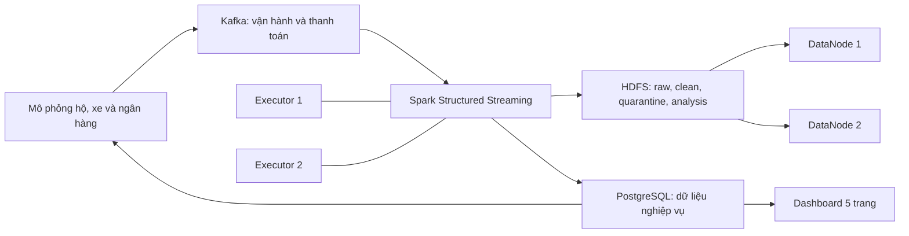

# Kiến trúc và nội dung báo cáo



## Sinh và xử lý dữ liệu

- Mỗi khung 12 giờ là một khoảng tính toán. Hộ có số người, hệ số hành vi và vị trí cố định. Xác suất phát sinh phụ thuộc loại rác, khung giờ, cuối tuần và khu. Khi phát sinh, lượng rác lấy theo phân phối Gamma; thời điểm sự kiện lấy ngẫu nhiên trong khung. Hội chợ ở sáu khu đầu ngày 07/11 làm tăng xác suất và khối lượng. Seed và số thứ tự khung cho phép lặp lại bộ số ngẫu nhiên với cùng trạng thái và cùng kịch bản.
- Tiền và khối lượng gốc lần lượt dùng đồng và gram nguyên. Thùng tích lũy đến khi có lượt gom. Khi gom, khối lượng chuyển từ thùng sang xe, khi đổ chuyển từ xe sang trạm. Đo cảm biến là ảnh chụp trạng thái, có thể gửi g hoặc kg, và được ghi độc lập với sự kiện phát sinh. Lỗi được cài có kiểm soát trên số đo gồm thiếu lượng, đơn vị sai, trùng, đến trễ và mất tín hiệu. Số đo đến trễ vẫn được lưu. Trạng thái chỉ tiến tới số đo mới hơn.
- Sự kiện từ bộ sinh dữ liệu được đẩy trực tiếp vào hai topic Kafka qua Kafka Producer. Mỗi topic có bốn partition; vận hành dùng mã thùng/xe, tài chính dùng mã hóa đơn làm khóa. Một broker đủ cho demo. Spark có hai executor trên hai worker, mỗi executor dùng hai core, tối đa bốn task cùng lúc. Driver giới hạn mỗi microbatch tối đa khoảng 12.000 offset. Spark phân tích schema, chuẩn hóa, so ID, tính mức đầy và tổng hợp theo ngày/thùng. Phần driver ghi kết quả có kích thước giới hạn theo batch vào PostgreSQL.
- HDFS ghi Parquet và checkpoint. Mỗi microbatch giữ đầy đủ raw theo Kafka offset. Một bản ghi đầu vào xuất hiện trong clean hoặc quarantine; layer analysis chứa tổng hợp phần đóng góp của batch theo ngày/thùng. Cộng các batch để ra tổng kỳ. Raw phân theo ngày nhận, clean và analysis theo ngày sự kiện.
- Bộ sinh dữ liệu ghi nhận offset đã gửi vào `kafka_produced` sau khi Kafka xác nhận. Spark ghi thư mục HDFS theo batch ID rồi commit sự kiện, tổng ngày, thanh toán, cursor (`kafka_cursor`) và marker batch cùng giao dịch PostgreSQL. Nếu phải xử lý lại một batch chưa commit, Spark ghi lại đúng đường dẫn. PostgreSQL và HDFS là hai hệ lưu trữ độc lập, nên có thể nhìn thấy một batch trên HDFS trước khi PostgreSQL commit.
- PostgreSQL chạy một instance làm lớp phục vụ. HDFS có hai bản sao block trên hai container cùng máy; mất cả host vẫn có thể mất cụm. Các đơn vị scale được minh họa bằng Kafka partition, Spark executor và HDFS DataNode. Con số 10.000 là số **đo trong 60 giây mô phỏng** ở chế độ cao điểm, không phải số bản ghi trên mỗi giây thực.

## Quy tắc nghiệp vụ

**Điều phối.** Thùng có rác và có số đo phù hợp được xét gom khi đầy từ 75% hoặc quá khoảng chờ. Gần đầy là 75% đến dưới 95%, đã đầy là 95% đến 100%, quá tải là trên 100%. Tuổi được tính từ lần gom gần nhất. Khi một xe có chỗ, hệ thống chấm điểm mỗi điểm theo độ đầy, tuổi, kg ước tính và trừ chi phí khoảng cách đường thẳng tính theo km. Chọn lần lượt tối đa năm điểm cho chuyến, cùng khu và cùng loại. Xe lấy tối đa tải còn lại; điểm gom một phần có thể được chọn lại. Xe về trạm cuối chuyến hoặc khi đầy và có thể quay lại nếu còn điểm chờ. Mỗi khung 12 giờ có tối đa bốn chuyến với xe hữu cơ và hai chuyến với xe tái chế hoặc xe rác còn lại. Nếu xe hỏng, số kg trên xe giữ nguyên, các điểm chưa gom về hàng chờ. Mỗi cặp khu/loại có một xe, vì vậy các điểm chờ xe đó hồi phục. Khoảng cách là mô hình tọa độ đơn giản. Đây là heuristic, không có cam kết tối ưu toàn cục.

**Kế hoạch.** Bắt đầu từ kỳ tháng 11 hoàn chỉnh. Hệ thống tính lượng phát sinh trung bình và quy đổi thành lượng rác dự kiến trong một khoảng gom so với sức chứa. Trên 80% thì đề xuất thêm 5 L và rút 24 giờ; dưới 25% thì đề xuất giảm 5 L và kéo dài 24 giờ. Giới hạn 10–100 L và 24–120 giờ. Kiểm tra tồn vật lý trước khi giảm, ghi kỳ, lý do, mức trước/sau, ngày hiệu lực và kết quả. Với đội xe theo khu và loại rác, khi số lượt gom vượt ngưỡng tải (`> 9 lượt/ngày`), hệ thống tự động bổ sung từ 1 lên 2 xe (`X-<khu>-<loại>-2`) vào hoạt động thực tế; khi nhu cầu giảm sẽ tự động rút xe thứ 2 về trạng thái dự phòng (`standby`).

Dự kiến phát sinh của kỳ tiếp theo lấy trung bình ngày của kỳ đã chốt nhân số ngày kỳ mới. Cột sử dụng tải là khối lượng đã đổ chia tổng tải trọng có thể chở của các chuyến đã kết thúc. Các bước đến điểm, đang gom và đổ tại trạm diễn ra trong cùng một khung mô phỏng. Log giữ thứ tự theo giờ mô phỏng, bảng nhiệm vụ hiển thị trạng thái mới nhất.

Cảnh báo Quá lâu hiển thị khi thùng còn rác và thời gian từ lần gom gần nhất đã chạm ngưỡng chờ của thùng. Cảnh báo này có thể xuất hiện cùng cảnh báo về mức đầy. Hộ quá hạn chưa thanh toán hoặc thanh toán thiếu tiền hiển thị Ngừng gom trong cột Điều phối xe. Trang Cảnh báo & Điều xe mặc định theo dõi bộ **30 thùng mẫu** (`WATCH_BINS`, hiển thị 13 dòng cùng lúc và tự động đẩy các thùng gặp sự cố cảm biến/xe hỏng hoặc quá tải lên đầu theo mức cảnh báo, hiệu ứng xanh khi vừa thu gom xong, kèm tùy chọn xem **Tất cả các thùng 10.800**). Trong ~35 giây đầu khi chạy demo từ mốc chuẩn (`step = 70`), 2 trong 3 hộ nợ quá hạn trong bộ 30 thùng mẫu (`H-0120`, `H-0340`) lần lượt thanh toán bù hóa đơn để xe mở lại thu gom, chỉ giữ lại 1 thùng nợ quá hạn cố định (`H-0020-O`).

**Hóa đơn.** Mỗi hộ một mã hóa đơn cho mỗi tháng. Tổng bằng phí cơ bản cộng tiền theo từng loại từ số kg thu gom đã qua Spark. Giá demo gồm 15.000 đ cơ bản, 750 đ/kg hữu cơ, 250 đ/kg tái chế và 1.100 đ/kg rác còn lại, cấu hình bằng các bảng `fee_config` và `tariff`. Làm tròn đến đồng theo từng loại trước khi cộng. Giá và chi tiết được chụp vào hóa đơn khi chốt, thay giá hiện tại không tính lại hóa đơn cũ. Kỳ chỉ chốt khi Spark đã xử lý hết offset Kafka đến mốc cuối kỳ.

**Thanh toán.** Nguồn giả lập đọc hóa đơn đã phát hành, sinh giao dịch theo thói quen từng hộ. PostgreSQL khóa hóa đơn khi đối soát và có chỉ mục duy nhất cho khoản khớp. Cùng mã/cùng dữ liệu là gửi lại, cùng mã/khác dữ liệu là xung đột, mã khác vào hóa đơn đã trả là khoản chuyển dư. Sai tiền, sai hộ và sai hóa đơn giữ log. Giao dịch đúng hộ, đúng mã hóa đơn và đủ số tiền (`exact_match`) hoặc thừa tiền (`overpaid_refund`) sẽ đóng hóa đơn để hộ vẫn được thu gom bình thường; trường hợp thừa tiền hoặc gửi sai mã sẽ liên hệ Phòng Đối Soát Tuấn Hùng bên ngoài hệ thống (SĐT `0392196240` / `doisoat@tuanhung.vn`) để hoàn tiền thừa. Giao dịch đúng mã hóa đơn nhưng thiếu tiền (`underpaid`) đưa hóa đơn vào trạng thái chờ đóng bù (`review`).

**Quá hạn.** Hóa đơn kỳ tháng 10 phát hành 01/11, nếu sau 1 tháng (đến 01/12) vẫn chưa thanh toán (`unpaid`) hoặc thanh toán thiếu tiền (`underpaid`) thì chuyển sang trạng thái quá hạn (`overdue`) và ngưng thu gom (xe bỏ qua hộ đó). Các kỳ sau theo quy tắc tương tự. Khi chuyển kỳ, đợi pipeline xử lý hết bản ghi trước mốc mới chốt kỳ và đổi trạng thái quá hạn. Nếu đã trả hết hóa đơn quá hạn, hộ trở lại điều phối tự động. Chính sách và đơn giá đều là giả định của đề tài.

## 5V có thể trình bày

| Tính chất | Bằng chứng |
| --- | --- |
| Volume | 10.800 thùng, nhật ký nhiều sự kiện, Parquet theo batch và ngày. Báo cáo số đo thực từ microbatch, không lấy số của bản cũ. |
| Velocity | Kafka → Spark theo microbatch, độ trễ đo từ timestamp Kafka tới trước commit PostgreSQL. |
| Variety | Phát sinh, đo cảm biến, xe, lượt gom, tín hiệu, giao dịch. Hai topic và nhiều kiểu sự kiện. |
| Veracity | Schema, quy đổi đơn vị, event ID, sự kiện đến muộn, quarantine, cân bằng khối lượng và đối soát tiền. |
| Value | Điều xe, điều chỉnh dung tích/lịch gom, chốt phí và kiểm soát nợ. |

## Nghiệm thu trên máy chạy demo

```powershell
docker compose exec -T namenode hdfs dfsadmin -report
docker compose exec -T namenode hdfs fsck /waste/batches -files -blocks -locations
docker compose exec -T kafka /opt/kafka/bin/kafka-get-offsets.sh --bootstrap-server kafka:9092 --topic waste-operations
Get-Content -Raw -Encoding UTF8 docs/audit.sql | docker compose exec -T postgres psql -U waste -d waste
```

Tạm dừng, đợi chỉ số **Đang chờ Spark xử lý** giảm về 0 trước khi đối chiếu. Sai lệch khối lượng theo thùng và xe phải bằng 0. Với Spark UI, chụp số task hoàn thành trên hai executor. Với HDFS, chụp số DataNode, replication và vị trí block. Với dashboard, chụp cả trạng thái lọc và thời điểm quan sát. Tính lưu lượng thực bằng số input chia thời gian quan sát thực và ghi rõ phạm vi. `duration_ms` là thời gian xử lý riêng của batch.

## Tài liệu tham khảo

- [Apache Spark 4.0.4 – Structured Streaming với Kafka](https://spark.apache.org/docs/4.0.4/streaming/structured-streaming-kafka-integration.html)
- [Apache Kafka 4.1 – Docker](https://kafka.apache.org/41/getting-started/docker/)
- [Apache Hadoop 3.5.0 – Kiến trúc HDFS](https://hadoop.apache.org/docs/r3.5.0/hadoop-project-dist/hadoop-hdfs/HdfsDesign.html)

